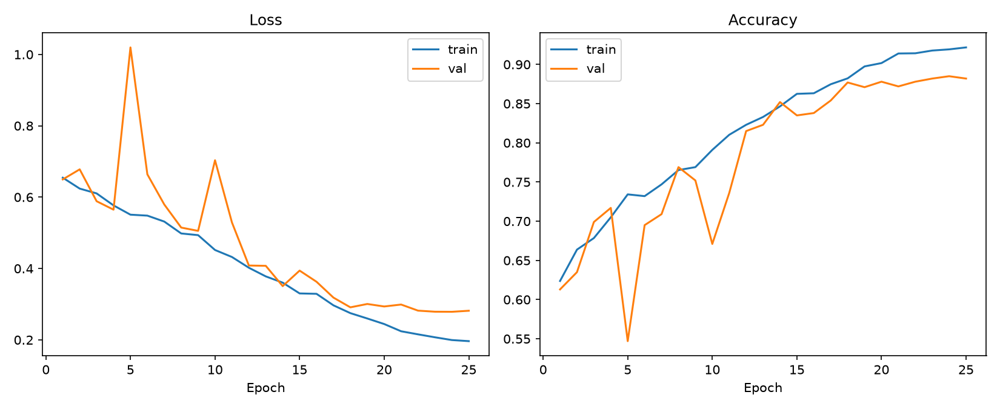
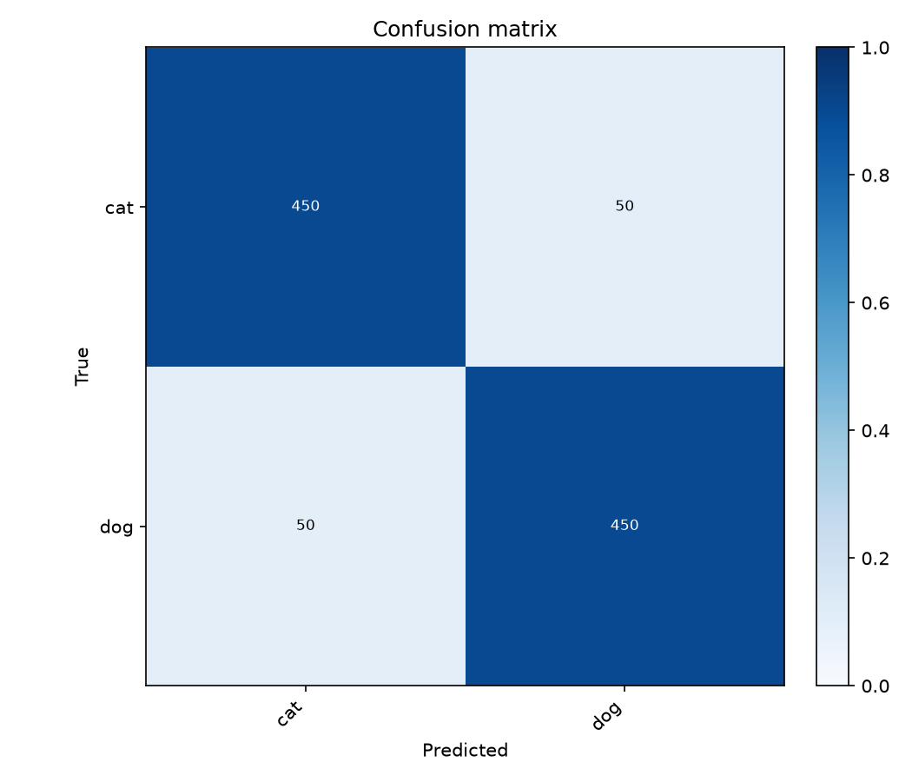
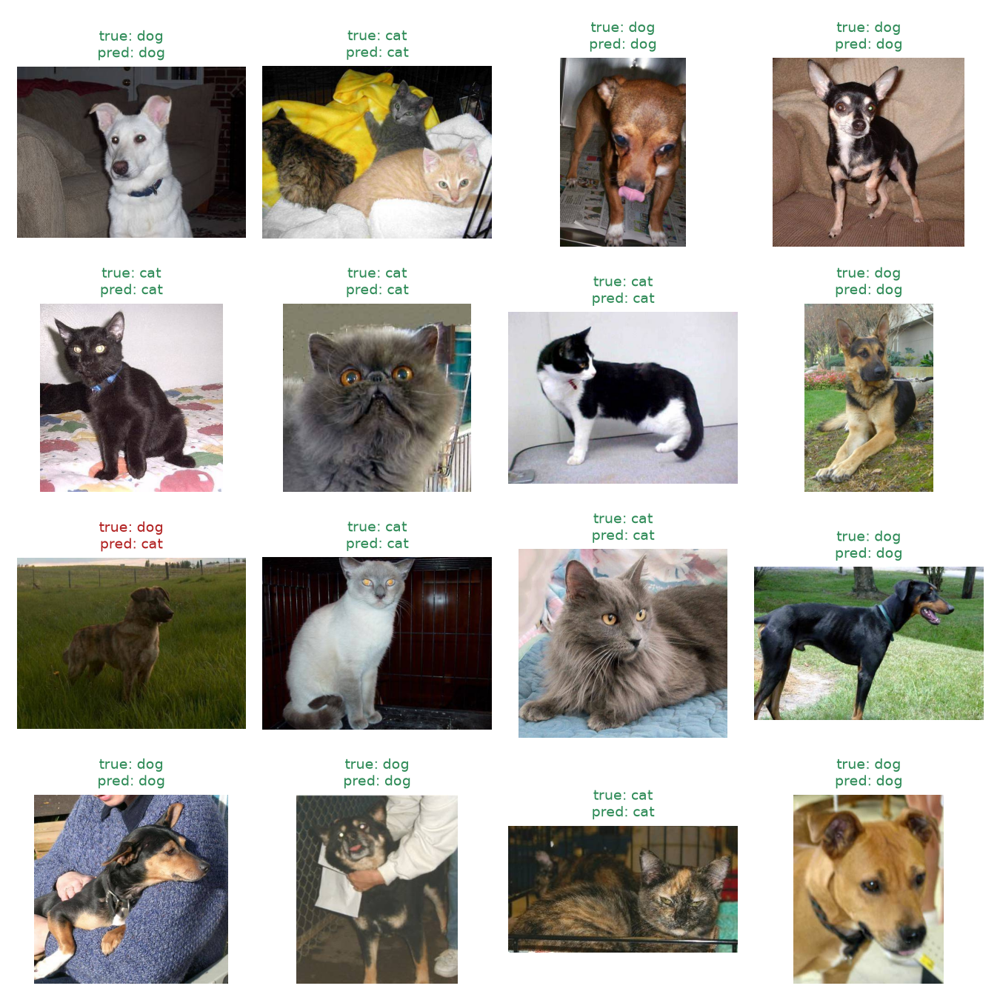
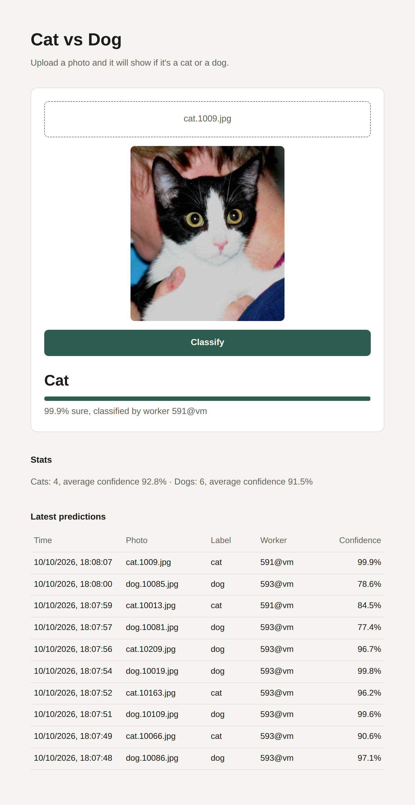

# Cat vs. Dog Classifier
A CNN that tells if a photo shows a cat or a dog. You can also try it on a web page, where the photos go into a queue in PostgreSQL and separate worker processes classify them.
## Data
The photos come from the Kaggle "Dogs vs. Cats" dataset. I use this copy of it from GitHub, which has about 25,000 photos: [laxmimerit/dog-cat-full-dataset](https://github.com/laxmimerit/dog-cat-full-dataset).
`src/prepare_data.py` downloads it and picks a random subset:
- train: 2000 cats and 2000 dogs
- val(validation): 500 cats and 500 dogs, from the same folder as train but different photos
- test: 500 cats and 500 dogs, from the dataset's separate test folder

The test photos are not used during training at all, only at the end in `src/evaluate.py`.
## Model
The model is in `src/model.py`. It has 4 convolutional blocks with 32, 64, 128 and 256 channels. Each block has two 3x3 convolutions. All photos are resized to 64x64. The original photos are much bigger, but training on them at full size would take too long on a CPU.
## Results
I trained for 25 epochs, which took about an hour and a half on my laptop's CPU. The best validation accuracy was 88.5% at epoch 24, and that is the model saved in `outputs/checkpoints/best_model.pt`.
On the 1000 test photos the model gets 90.0% accuracy:

```
              precision    recall  f1-score   support

         cat      0.900     0.900     0.900       500
         dog      0.900     0.900     0.900       500

    accuracy                          0.900      1000
   macro avg      0.900     0.900     0.900      1000
weighted avg      0.900     0.900     0.900      1000
```


Training accuracy goes up to about 92%, while validation accuracy stays around 88%. So the model overfits a little, which is expected for a small network trained from scratch on 4000 photos.



50 of the 500 cats were classified as dogs and 50 of the 500 dogs as cats, so the mistakes are split evenly between the two classes.


## Web page
The web page has three parts:
- the server (`api/main.py`)
- the PostgreSQL database (`api/schema.sql`) 
- the workers (`api/worker.py`)
The workers only talk to the database, so you can start as many as you want, also on other computers. 



The page asks the server every second how the photo is doing, so it shows when the photo is in the queue, when a worker is classifying it, and then the result.
## Running on AWS
I deployed it on AWS, on the free plan. The server and two workers run on an EC2 instance (t3.small with Ubuntu), and the database is on RDS. The database is not public, so only the EC2 instance can connect to it.
While my free plan lasts, the page is at http://16.192.249.49:8000.
## How to run
```
pip install -r requirements.txt
python src/prepare_data.py
python src/train.py
python src/evaluate.py
python src/predict.py examples/cat_example.jpg
```
`prepare_data.py` creates the `data/` folder, `train.py` trains the model, `evaluate.py` tests it and saves the figures, and `predict.py` shows the prediction for one photo. You can also try `predict.py` on your own photos, but the model only knows cats and dogs, so any other picture will still be labeled as one of them.
For the web page you also need PostgreSQL, with an empty database called `catdog` (the table is created automatically). Start the server and at least one worker, each in its own terminal:

```
uvicorn api.main:app
python -m api.worker
```
Then open http://localhost:8000. The server and the workers connect to `postgresql://localhost:5432/catdog`, and you can set `DATABASE_URL` to use another database.
